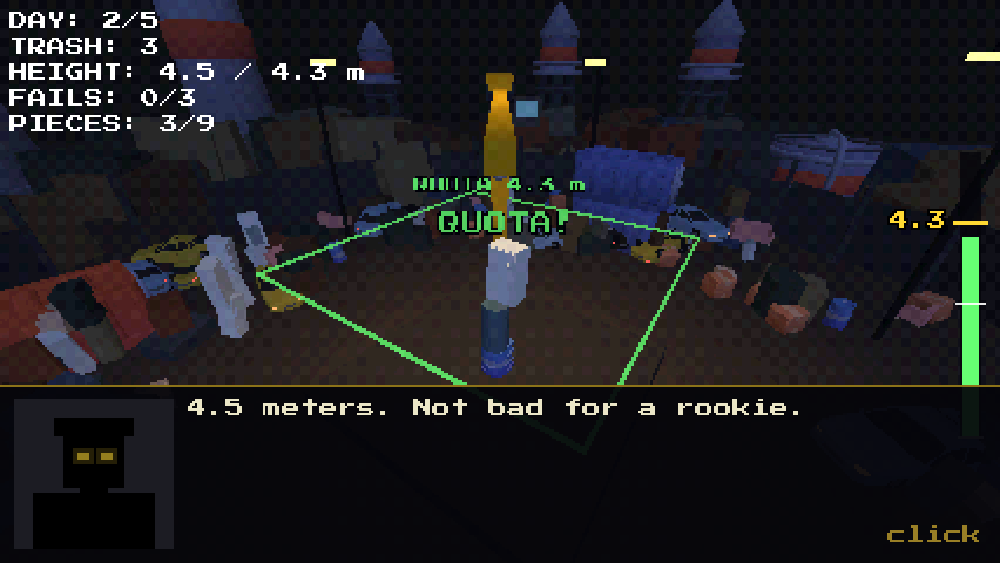
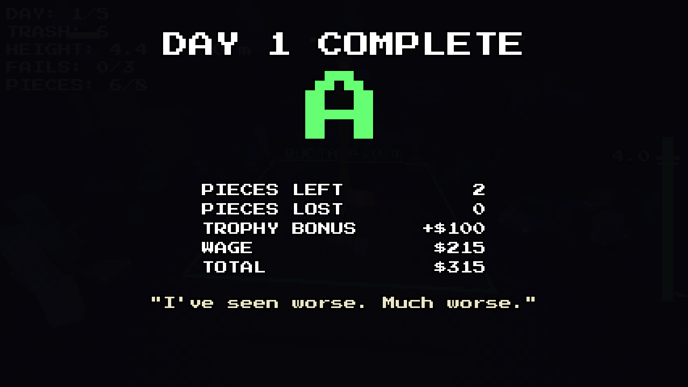
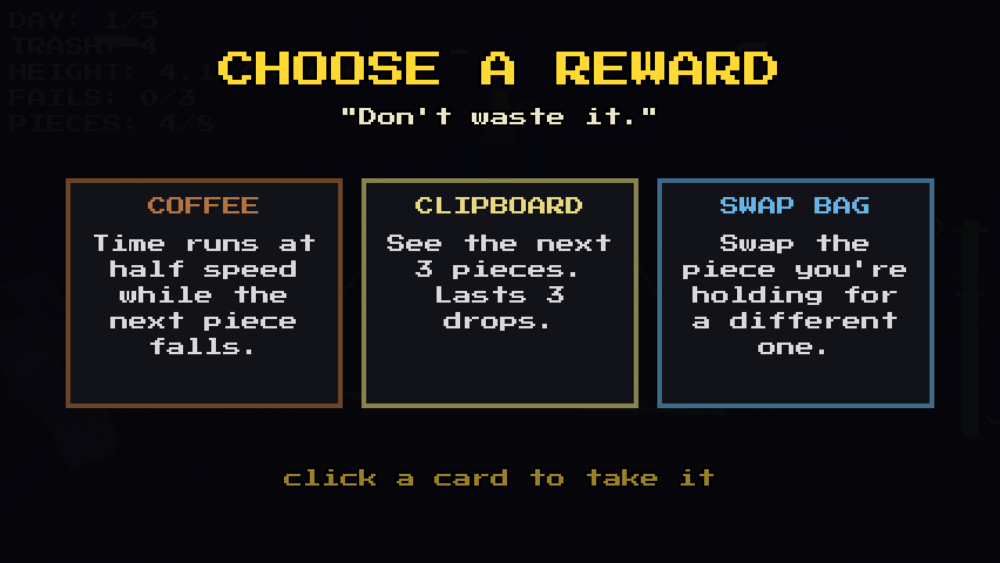
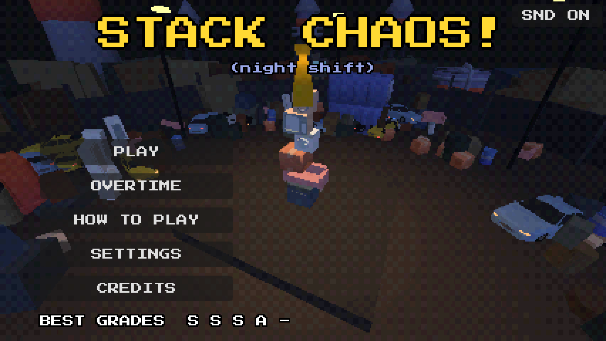

# Stack Chaos!

> เกมกองขยะ 3D แบบฟิสิกส์ — เป็นพนักงานโรงขยะ กองขยะให้สูงถึงโควต้าของ boss ให้ได้ครบ 5 วัน ไม่งั้น **YOU'RE FIRED!**
> จบแล้วยังมีโหมด **OVERTIME** ไม่มีที่สิ้นสุดให้ท้าทายสถิติตัวเอง

**▶ เล่นบนเว็บ:** [itch.io](https://coconuttm.itch.io/stack-chaos)
**📱 เล่นบนมือถือได้ (แนวนอน):** ลากนิ้วเพื่อเล็ง แล้วกดปุ่ม DROP / ใช้สองนิ้วลากหมุนกล้อง บีบเพื่อซูม


---

## เกี่ยวกับเกม

คุณเป็นพนักงานกะดึกของโรงขยะ boss ที่ยืนอยู่ในเงามืด (เห็นแค่ดวงตาเรืองแสง) ตั้งโควต้าความสูงของกองขยะในแต่ละวัน
ใช้เครนหย่อนขยะทีละชิ้นลงบนแท่น ซ้อนให้สูงที่สุดโดยไม่ให้อะไรร่วงตกขอบ

- **5 วัน** แต่ละวันมีโควต้าความสูงและจำนวนชิ้นจำกัด
- ทำชิ้นเสีย (หลุดขอบ / ตกพื้น / กองล้ม) ครบ **3 ชิ้น** หรือใช้ชิ้นหมดแล้วยังไม่ถึงโควต้า = โดนไล่ออก
- ยิ่งวันหลังยิ่งยาก: ขยะชนิดใหม่ + สภาพอากาศ
- จบแต่ละวันได้ **เกรด S / A / B / C** และเงินเดือน — เล่นดีได้เลือกรางวัล
- **ร้านของ boss:** เงินเดือนเอาไปซื้อ item ท้ายวันได้ หรือขาย item คืน boss เป็นเงินสด
- **สินบน:** โดนไล่ออกแล้วมีเงินพอ boss ยอมให้จ่ายเพื่อเล่นวันนั้นใหม่ — ใช้เงินซื้อของตอนนี้ หรือเก็บไว้กันตกงาน (แต่ยิ่งติดสินบนบ่อย boss ยิ่งระแวง)
- ผ่านครบ 5 วันแล้วปลดล็อก **OVERTIME** (โควต้าสูงขึ้นเรื่อยๆ จนกว่าจะโดนไล่ออก)

| วัน | โควต้า | ชิ้น | สิ่งที่เพิ่มเข้ามา |
| --- | --- | --- | --- |
| 1 | 2.8 | 8 | สอนเล่น |
| 2 | 4.3 | 9 | ถังน้ำมัน (ลื่น), ลังเหล็ก (หนัก), รถ, โซฟา, ถังขยะ, **ถ้วยทอง** (วางนิ่งได้ = โบนัสเงิน) |
| 3 | 5.8 | 10 | **ลมกระโชก**, ทีวี (เปราะ — เสียชิ้นนี้ = โดนไล่ออกทันที), ถังน้ำ, **ที่นอน** (เด้ง) |
| 4 | 7.3 | 11 | **ฝนตก** (ทุกอย่างลื่นขึ้น), ชักโครก |
| 5 | 8.8 | 12 | **ลม + แผ่นดินไหว** |

> โควต้าเป็นเมตร นับจากผิวแท่น (ค่าเดียวกับที่แสดงใน HUD `HEIGHT: ปัจจุบัน / โควต้า`)



**ดูความสูงได้ 3 ทาง:** กรอบเรืองแสงรอบแท่นที่ความสูงโควต้า (กะพริบเมื่อใกล้ เป็นสีเขียวเมื่อถึง) / แถบวัดขอบขวาจอ (ระดับกอง, สถิติของวัน, ขีดโควต้า)
/ ข้อความเด้งเหนือชิ้นที่เพิ่งวาง (`+0.8 m`, `NEW BEST!`, `ALMOST!`, `QUOTA!`)

## วิธีเล่น

| ปุ่ม | ผล |
| --- | --- |
| ขยับเมาส์ | เลื่อนชิ้นขยะที่เครนถืออยู่ |
| คลิกซ้าย | ปล่อยชิ้นขยะ / ข้ามบทพูดของ boss |
| คลิกขวา (สั้นๆ) | หมุนชิ้น 45° (หรือกด Q / E) |
| Shift + คลิกขวา / คลิกกลาง | พลิกชิ้นตะแคง 90° (หรือกด R) |
| คลิกขวาค้าง + ลาก | หมุนกล้องรอบกอง 360° |
| ลูกกลิ้งเมาส์ | ซูมกล้องเข้า/ออก |
| คลิกช่อง item ด้านล่าง | ใช้ item |
| P / Esc / ปุ่ม PAUSE | หยุดเกม (มีปุ่ม SETTINGS ในเมนู pause) |
| Esc / ปุ่ม SKIP >> ตอน boss พูด | ข้ามบทพูดชุดนั้นทั้งชุด |
| Space / Enter | เหมือนคลิกซ้ายบนบทพูด / หน้าสรุปผลงาน / หน้าจบ |
| 1 / 2 / 3 | เลือกการ์ดรางวัล / สินบน |
| C | คืนมุมกล้อง |
| F11 | เต็มจอ |

**วงเงาใต้ชิ้น** บอกจุดที่จะตก — ถ้าเป็น **สีแดง** แปลว่าจะตกลงพื้น ไม่ใช่บนกอง

### Item

boss แจก item วันละ 2 ชิ้น (เก็บได้สูงสุด 6 ช่อง ค้างข้ามวันได้) + ได้เกรด A ขึ้นไปเลือกรางวัลเพิ่มได้ 1 ใน 3 ชิ้น — แถบ item ด้านล่างโชว์เป็นไอคอน ชี้เมาส์เพื่ออ่านคำอธิบาย

| Item | ผล |
| --- | --- |
| **Duct Tape** | ติดชิ้นล่าสุดที่วางแล้วเข้ากับกองแบบถาวร |
| **Coffee** | เวลาช้าลงครึ่งหนึ่งระหว่างชิ้นถัดไปกำลังตก |
| **Swap Bag** | เปลี่ยนชิ้นที่ถืออยู่เป็นชิ้นอื่น |
| **Counterweight** | ชิ้นที่ถืออยู่หนักขึ้น 3 เท่า |
| **Clipboard** | ดูชิ้นถัดไป 3 ชิ้น (ใช้ได้ 3 ครั้งที่ปล่อย) |
| **Insurance** | ยกเว้นการทำชิ้นเสีย 1 ครั้ง |

## ร้านของ boss + สินบน

เงินเดือนที่ได้แต่ละวันเอาไปใช้ได้ 2 ทาง:

- **ร้านของ boss** — หลังใบประเมินผลงานและเลือกรางวัล boss เปิดร้านวางขาย item 3 ชิ้น ซื้อได้หลายชิ้นจนกดออก (ร้านเปิดเมื่อเงินพอซื้อหรือมี item ให้ขายคืน)

| Item | ราคา |
| --- | --- |
| Coffee / Swap Bag | $60 |
| Counterweight / Clipboard | $80 |
| Duct Tape | $120 |
| Insurance | $150 |

  ในร้านยัง **ขาย item คืน boss** ได้ (ครึ่งราคา) เผื่อต้องการเงินสด — เอาไปจ่ายสินบนได้

- **สินบน** — ถ้าโดนไล่ออกแล้วมีเงินพอ boss จะเสนอให้จ่ายเพื่อ **เล่นวันนั้นใหม่** (โควต้าและตัวปรับของวันเหมือนเดิม ไม่แจก item ซ้ำ) ราคาเริ่ม **$250** แล้วเพิ่มเป็นสองเท่าทุกครั้งในรอบเดียวกัน (250 → 500 → 1000) — วันที่ 1 ยังไม่มีเงินจึงไม่มีข้อเสนอ
- **ความระแวงของ boss** — จ่ายสินบนทุกครั้งทำให้ boss ระแวงขึ้น: ตาเปลี่ยนจากเหลือง → ส้ม → แดง และบทพูดเปลี่ยนไป ถ้าระแวงถึงขีดสุด ต้นวันถัดไป boss จะ **ตรวจ**: ยึดเงินครึ่งหนึ่ง และวันนั้นไม่รับสินบน (ผ่านวันโดยไม่ติดสินบนช่วยให้ boss คลายระแวง)
- **ฉากจบพิเศษ** — ผ่านวันที่ 5 โดยติดสินบนมาหลายครั้ง จะได้ฉากจบอีกแบบ (หน้า title โชว์ `ENDINGS x/2`)

## ใบประเมินผลงาน + รางวัล

|  |  |
| --- | --- |

ผ่านวันแล้วขึ้นใบประเมิน: เกรดคิดจากชิ้นที่เสียและชิ้นที่เหลือ เงินเดือน = ค่าแรงตามวัน + ชิ้นที่เหลือ + โบนัสเกรด (+ ถ้วยทอง)

| เกรด | เงื่อนไข | โบนัส |
| --- | --- | --- |
| **S** | ไม่เสียเลย และเหลืออย่างน้อย 3 ชิ้น | $60 |
| **A** | เสียไม่เกิน 1 และเหลืออย่างน้อย 1 ชิ้น | $30 |
| **B** | เสียไม่เกิน 2 และเหลืออย่างน้อย 1 ชิ้น | $10 |
| **C** | ผ่านแบบเฉียดฉิว (ใช้ชิ้นสุดท้าย) | — |

ได้ **A หรือ S** → boss ให้เลือก item 1 ใน 3 ใบ / เกรดดีที่สุดของแต่ละวันโชว์บนหน้า title

## โหมด OVERTIME

ปลดล็อกหลังผ่านครบ 5 วัน (ปุ่ม OVERTIME บนหน้า title) — กะละ +1.5 ม. และ +2 ชิ้น สุ่มตัวปรับของวัน 1–2 อย่าง ไม่มีวันสุดท้าย
โดนไล่ออก = จบรอบ เกมจำสถิติจำนวนกะที่รอดได้มากที่สุด

### ตัวปรับของวัน

| ตัวปรับ | ผล | เจอที่ |
| --- | --- | --- |
| **WIND** | ลมกระโชกเป็นช่วง มีนับถอยหลัง + ลูกศรบอกทิศ | วัน 3, 5, OVERTIME |
| **RAIN** | ทุกอย่างลื่นขึ้น | วัน 4, OVERTIME |
| **QUAKE** | แผ่นดินไหวเป็นช่วง กองโยกทั้งกอง | วัน 5, OVERTIME |
| **BLACKOUT** | ไฟกะพริบแล้วดับไปสองสามวินาที (วงนำทางยังเห็น) | OVERTIME |
| **FOG** | หมอกหนาทั้งวัน ดูแถบวัดความสูงแทน | OVERTIME |

## SETTINGS

เปิดได้จากหน้า title และเมนู pause: **VOLUME** / **CAMERA SPEED** (ความไวตอนลากหมุนกล้อง) / **RETRO LOOK** — ปิดแล้วไม่มี dither และ vertex snapping
ภาพคมขึ้นและเบาเครื่องลง (แนะนำถ้าเล่นบนเว็บแล้วกระตุก) — ค่าทั้งหมดจำไว้ข้ามการเปิดเกม

## ฟีเจอร์

- ฟิสิกส์การซ้อนด้วย **Jolt Physics** + ความ "เหนียว" แบบเยลลี่ + ศูนย์ถ่วงต่ำแบบตุ๊กตาล้มลุก ชิ้นที่ยื่นเลยขอบเล็กน้อยจะค่อยๆ เอียงแทนที่จะล้มทันที
  (ชิ้นแรกของกองไม่สุ่มเป็นชิ้นเล็ก/กลมที่ทำเป็นฐานไม่ได้)
- เครนทาวเวอร์ที่ยืนอยู่กับที่ (กล้องโคจรรอบกองได้ 360° แล้วเครนไม่หมุนตาม) + ซูมเข้า/ออกด้วยลูกกลิ้ง
- เครนเก่า **ส่ายตลอด** ชิ้นที่ถือจึงไม่นิ่งสนิท ต้องจับจังหวะปล่อย (ยิ่งวันหลังยิ่งส่ายมาก) / ลากเมาส์เลยระยะเอื้อมจะแกว่งแรงขึ้นและขึ้น `OUT OF REACH`
- boss พูดแบบพิมพ์ทีละตัวอักษร (แรงบันดาลใจจาก *Buckshot Roulette*) และมีฉากจบ
- ขยะ 18 ชนิด ชนิดพิเศษมีคุณสมบัติต่างกัน (ลื่น / หนัก / เปราะ / เด้ง / โบนัส)
- ลุค **PS1**: vertex snapping, แสงเป็นขั้น, ลดสี + dithering, หมอก, ไฟกะพริบ
- สุ่มขยะแบบ "ถุง" (ได้ครบทุกชนิดก่อนวนซ้ำ ไม่ซวยติดกัน)
- หน้า title มีชีวิต: กล้องหมุนรอบกองตัวอย่าง + เมนู PLAY / OVERTIME / HOW TO PLAY / SETTINGS / CREDITS



## เทคนิค

| | |
| --- | --- |
| Engine | Godot 4.7 (GDScript) |
| Renderer | Compatibility (WebGL 2) — รันบนเว็บได้ |
| Physics | Jolt Physics |
| ความละเอียด UI | 426×240 ขยายเป็นจำนวนเต็มเท่า (หน้าต่างเริ่มต้น 1280×720) |
| Web export | single-threaded (ไม่ต้องใช้ SharedArrayBuffer) |

### รันจากซอร์สโค้ด

```bash
git clone https://github.com/coconutTM/Stack-Chaos.git
cd Stack-Chaos
godot --path .                     # รันเกม (ต้องมี Godot 4.7)
godot -e --path .                  # เปิดใน editor
godot --headless --path . --export-release "Web" build/web/index.html   # export เว็บ
```

### โครงสร้างโปรเจกต์

```
data/       ค่าจูนเกม: วัน/โควต้า/เกรด/OVERTIME/ตัวปรับของวัน (game_data.gd), บทพูด (dialogue.gd), item (items.gd), โมเดล 3D ของ item (item_models.gd)
scripts/    โค้ดเกม — main.gd คือตัวคุมเกม, block.gd คือชิ้นขยะ, title_menu / review_screen / item_choice / boss_shop / settings_panel คือหน้าจอต่างๆ
scenes/     main.tscn + scenes/blocks/ (ชิ้นขยะแยกไฟล์ละชนิด)
shaders/    PSX shader + post-process
assets/     โมเดล 3D + ไอคอน item (icons/ อบจากโมเดลด้วย tools/bake_icons.gd)
audio/      เสียงของเกม (.wav ที่อบจากเสียงสังเคราะห์ในโค้ด scripts/sfx.gd ด้วย tools/bake_sfx.gd)
tools/      สคริปต์ช่วยพัฒนา: อบเสียง (bake_sfx.gd) / อบไอคอน item (bake_icons.gd) (ไม่ถูก export)
fonts/      ฟอนต์ pixel
```

## เครดิต

**พัฒนาโดย:** 683380290-0 นายฐากูร มูลวิชา, 683380294-2 นายธนกร มีฤทธิ์, 683380299-2 นายธันยบูรณ์ สินเธาว์, 683380304-5 นายปรเมษฐ์ จันทมิฬ — วิชา CP352203 Computer Game Development ภาคต้น ปีการศึกษา 2569

| ทรัพยากร | ผู้สร้าง | ไลเซนส์ |
| --- | --- | --- |
| [Survival Kit](https://kenney.nl/assets/survival-kit), [Furniture Kit](https://kenney.nl/assets/furniture-kit), [City Kit Industrial](https://kenney.nl/assets/city-kit-industrial) | Kenney | CC0 |
| [Cars Bundle](https://poly.pizza/bundle/Cars-Bundle-FE5IWe6OMk) | Quaternius | CC0 |
| ฟอนต์ [Press Start 2P](https://fonts.google.com/specimen/Press+Start+2P) | CodeMan38 | SIL OFL 1.1 |
| เสียงทั้งหมด (สังเคราะห์ด้วยโค้ด) | ทีมผู้พัฒนา | — |

รายละเอียดเครดิตโมเดล: [`assets/models/CREDITS.md`](assets/models/CREDITS.md)

**เกมที่เป็นแรงบันดาลใจ:** Buckshot Roulette, Super Stacker 2, Tower Bloxx, Stack
