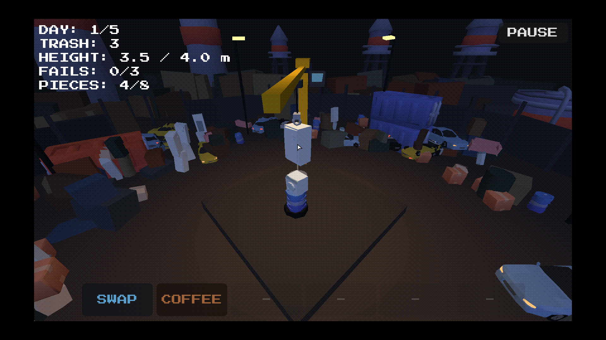

# Stack Chaos!

> เกมกองขยะ 3D แบบฟิสิกส์ — เป็นพนักงานโรงขยะ กองขยะให้สูงถึงโควต้าของ boss ให้ได้ครบ 5 วัน ไม่งั้น **YOU'RE FIRED!**

**▶ เล่นบนเว็บ:** [itch.io](https://coconuttm.itch.io/stack-chaos)



---

## เกี่ยวกับเกม

คุณเป็นพนักงานกะดึกของโรงขยะ boss ที่ยืนอยู่ในเงามืด (เห็นแค่ดวงตาเรืองแสง) ตั้งโควต้าความสูงของกองขยะในแต่ละวัน
ใช้เครนหย่อนขยะทีละชิ้นลงบนแท่น ซ้อนให้สูงที่สุดโดยไม่ให้อะไรร่วงตกขอบ

- **5 วัน** แต่ละวันมีโควต้าความสูงและจำนวนชิ้นจำกัด
- ทำชิ้นเสีย (หลุดขอบ / ตกพื้น / กองล้ม) ครบ **3 ชิ้น** หรือใช้ชิ้นหมดแล้วยังไม่ถึงโควต้า = โดนไล่ออก
- ยิ่งวันหลังยิ่งยาก: ขยะชนิดใหม่ + สภาพอากาศ

| วัน | โควต้า | ชิ้น | สิ่งที่เพิ่มเข้ามา |
| --- | --- | --- | --- |
| 1 | 4.0 | 8 | สอนเล่น |
| 2 | 5.5 | 9 | ถังน้ำมัน (ลื่น), ลังเหล็ก (หนัก), รถ, โซฟา, ถังขยะ |
| 3 | 7.0 | 10 | **ลมกระโชก**, ทีวี (เปราะ — เสียชิ้นนี้ = โดนไล่ออกทันที), ถังน้ำ |
| 4 | 8.5 | 11 | **ฝนตก** (ทุกอย่างลื่นขึ้น), ชักโครก |
| 5 | 10.0 | 12 | **ลม + แผ่นดินไหว** |

> โควต้าเป็นค่าเดียวกับที่แสดงใน HUD (`HEIGHT: ปัจจุบัน / โควต้า`)

## วิธีเล่น

| ปุ่ม | ผล |
| --- | --- |
| ขยับเมาส์ | เลื่อนชิ้นขยะที่เครนถืออยู่ |
| คลิกซ้าย | ปล่อยชิ้นขยะ / ข้ามบทพูดของ boss |
| คลิกขวา (สั้นๆ) | พลิกชิ้นตะแคง 90° |
| คลิกขวาค้าง + ลาก | หมุนกล้องรอบกอง 360° |
| ลูกกลิ้งเมาส์ | หมุนชิ้น ±45° |
| คลิกช่อง item ด้านล่าง | ใช้ item |
| P / Esc / ปุ่ม PAUSE | หยุดเกม |

**วงเงาใต้ชิ้น** บอกจุดที่จะตก — ถ้าเป็น **สีแดง** แปลว่าจะตกลงพื้น ไม่ใช่บนกอง

### Item

boss แจก item วันละ 2 ชิ้น (เก็บได้สูงสุด 6 ช่อง ค้างข้ามวันได้)

| Item | ผล |
| --- | --- |
| **Duct Tape** | ติดชิ้นล่าสุดที่วางแล้วเข้ากับกองแบบถาวร |
| **Coffee** | เวลาช้าลงครึ่งหนึ่งระหว่างชิ้นถัดไปกำลังตก |
| **Swap Bag** | เปลี่ยนชิ้นที่ถืออยู่เป็นชิ้นอื่น |
| **Counterweight** | ชิ้นที่ถืออยู่หนักขึ้น 3 เท่า |
| **Clipboard** | ดูชิ้นถัดไป 3 ชิ้น (ใช้ได้ 3 ครั้งที่ปล่อย) |
| **Insurance** | ยกเว้นการทำชิ้นเสีย 1 ครั้ง |

## ฟีเจอร์

- ฟิสิกส์การซ้อนด้วย **Jolt Physics** + ความ "เหนียว" แบบเยลลี่ ชิ้นที่ยื่นเลยขอบเล็กน้อยจะค่อยๆ เอียงแทนที่จะล้มทันที
- เครนทาวเวอร์ + กล้องโคจร 360°
- boss พูดแบบพิมพ์ทีละตัวอักษร (แรงบันดาลใจจาก *Buckshot Roulette*) และมีฉากจบ
- ขยะ 16 ชนิด ชนิดพิเศษมีคุณสมบัติต่างกัน (ลื่น / หนัก / เปราะ)
- ลุค **PS1**: vertex snapping, แสงเป็นขั้น, ลดสี + dithering, หมอก, ไฟกะพริบ
- สุ่มขยะแบบ "ถุง" (ได้ครบทุกชนิดก่อนวนซ้ำ ไม่ซวยติดกัน)

## เทคนิค

| | |
| --- | --- |
| Engine | Godot 4.7 (GDScript) |
| Renderer | Compatibility (WebGL 2) — รันบนเว็บได้ |
| Physics | Jolt Physics |
| ความละเอียด UI | 426×240 ขยายเป็นจำนวนเต็มเท่า (หน้าต่างเริ่มต้น 1280×720) |
| Web export | single-threaded (ไม่ต้องใช้ SharedArrayBuffer) |

### รันจากซอร์สโค้ด

```bash
git clone https://github.com/coconutTM/Stack-Chaos.git
cd Stack-Chaos
godot --path .                     # รันเกม (ต้องมี Godot 4.7)
godot -e --path .                  # เปิดใน editor
godot --headless --path . --export-release "Web" build/web/index.html   # export เว็บ
```

### โครงสร้างโปรเจกต์

```
data/       ค่าจูนเกม: วัน/โควต้า (game_data.gd), บทพูด (dialogue.gd), item (items.gd)
scripts/    โค้ดเกม — main.gd คือตัวคุมเกม, block.gd คือชิ้นขยะ
scenes/     main.tscn + scenes/blocks/ (ชิ้นขยะแยกไฟล์ละชนิด)
shaders/    PSX shader + post-process
assets/     โมเดล 3D
audio/      ไฟล์เสียง (ไม่มีไฟล์ = ใช้เสียงสังเคราะห์จากโค้ด)
fonts/      ฟอนต์ pixel
```

## เครดิต

**พัฒนาโดย:** 683380290-0 นายฐากูร มูลวิชา, 683380294-2 นายธนกร มีฤทธิ์, 683380299-2 นายธันยบูรณ์ สินเธาว์, 683380304-5 นายปรเมษฐ์ จันทมิฬ — วิชา CP352203 Computer Game Development ภาคต้น ปีการศึกษา 2569

| ทรัพยากร | ผู้สร้าง | ไลเซนส์ |
| --- | --- | --- |
| [Survival Kit](https://kenney.nl/assets/survival-kit), [Furniture Kit](https://kenney.nl/assets/furniture-kit), [City Kit Industrial](https://kenney.nl/assets/city-kit-industrial) | Kenney | CC0 |
| [Cars Bundle](https://poly.pizza/bundle/Cars-Bundle-FE5IWe6OMk) | Quaternius | CC0 |
| ฟอนต์ [Press Start 2P](https://fonts.google.com/specimen/Press+Start+2P) | CodeMan38 | SIL OFL 1.1 |

รายละเอียดเครดิตโมเดล: [`assets/models/CREDITS.md`](assets/models/CREDITS.md)

**เกมที่เป็นแรงบันดาลใจ:** Buckshot Roulette, Super Stacker 2, Tower Bloxx, Stack
